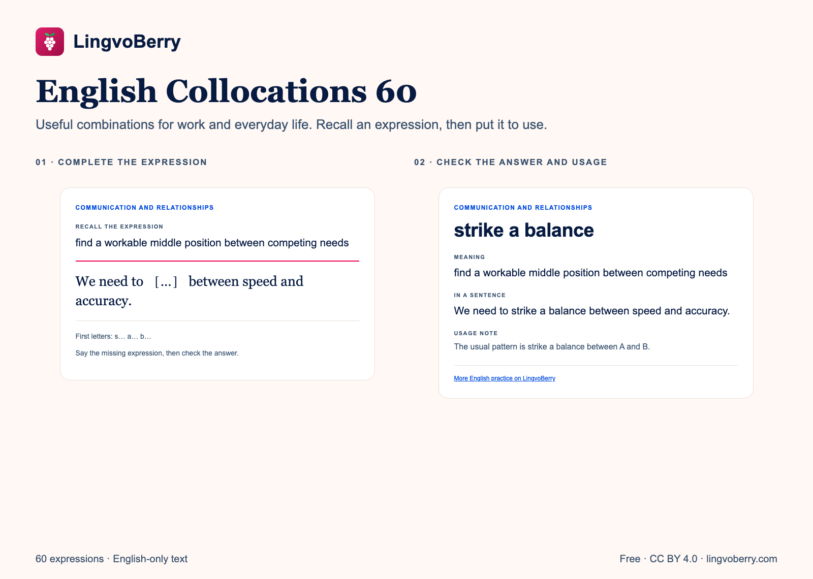
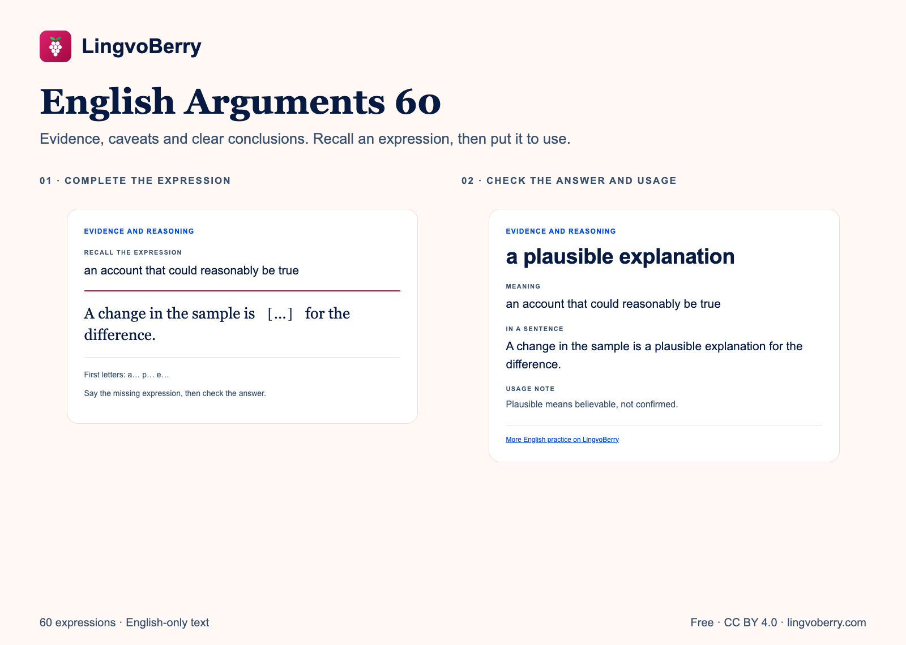

# Free English practice packs by LingvoBerry

Choose a pack, download the Anki deck or editable CSV, and practise offline. All packs are free to share and adapt under CC BY 4.0 with attribution.

| Pack | For | Cards | Downloads |
|---|---|---:|---|
| [English Starter 100](packs/english-starter-100) | Everyday vocabulary for beginners | 100 | [Anki + CSV + ZIP](https://github.com/antkmorn/lingvoberry-learning-resources/releases/tag/starter100-v1.2) |
| [English Collocations 60](packs/english-collocations-60) | Intermediate learners: natural combinations at work and in everyday life | 60 | [Anki + CSV + ZIP](https://github.com/antkmorn/lingvoberry-learning-resources/releases/tag/collocations60-v1) |
| [English Arguments 60](packs/english-arguments-60) | Upper-intermediate and advanced learners: evidence, caveats and conclusions | 60 | [Anki + CSV + ZIP](https://github.com/antkmorn/lingvoberry-learning-resources/releases/tag/arguments60-v1) |

## English Collocations 60

## English Arguments 60

The two expression decks include a meaning, a sentence with a gap, first-letter hints, the full example and a usage note. Make a sentence of your own after checking the answer. The learner ranges are practical guides, not certified CEFR assessments.

English-only text cards, without audio or translations. The optional LingvoBerry links need internet access. See each pack for its topics, instructions and source link.

[CC BY 4.0](https://creativecommons.org/licenses/by/4.0/) · LingvoBerry
