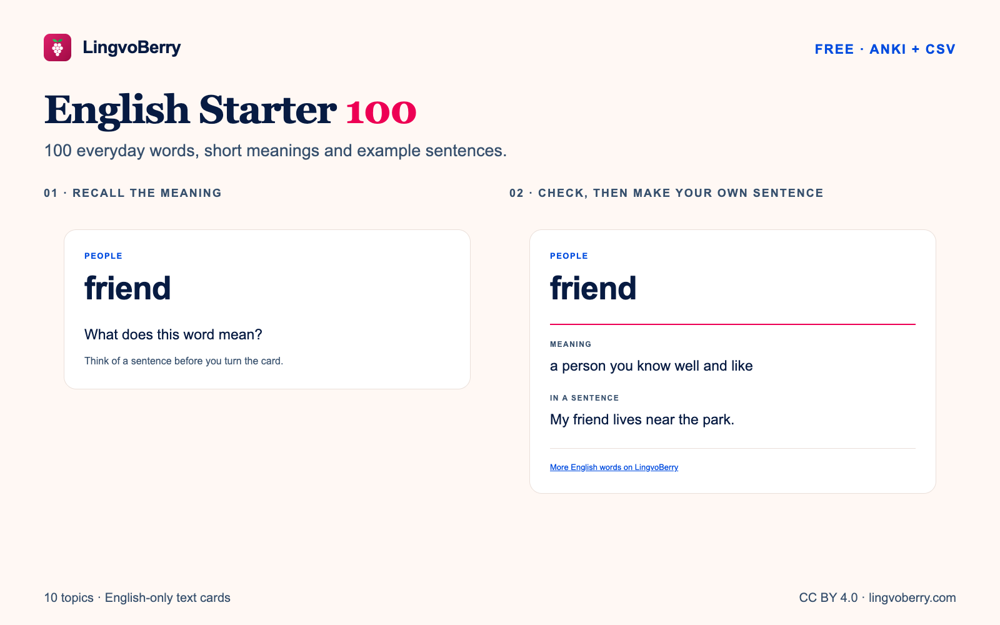

# English Starter 100

**100 everyday words. Clear meanings. Examples you can use.**

A free English vocabulary pack by LingvoBerry for self-study and classroom practice.

## Choose your format

| Format | What you get | Download |
|---|---|---|
| **Anki** | 100 flashcards, organised by topic | [Get the Anki deck](https://github.com/antkmorn/lingvoberry-learning-resources/releases/download/starter100-v1.2/lingvoberry-english-starter-100.apkg) |
| **CSV** | Word, meaning, example, topic and source; ready to adapt | [Get the CSV](https://github.com/antkmorn/lingvoberry-learning-resources/releases/download/starter100-v1.2/lingvoberry-english-starter-100.csv) |
| **Complete pack** | Anki, CSV, previews, instructions and license in one ZIP | [Get the complete pack](https://github.com/antkmorn/lingvoberry-learning-resources/releases/download/starter100-v1.2/lingvoberry-english-starter-100.zip) |

The downloads are free. No account or subscription is required to download them. Open the deck with Anki or AnkiDroid; open the CSV with a spreadsheet or flashcard tool.

## A look inside

**friend** · people

> A person you know well and like.
>
> “My friend lives near the park.”

Each card follows the same pattern: a word on the front, then a short English meaning and an example on the back. The pack contains text cards, without audio or translations. Each word covers one useful meaning.

## Ten everyday topics

People · home · food · places · time · learning · actions · feelings · describing things · everyday tasks.

Use the topic tags in Anki to practise a smaller group. Teachers can filter the CSV by topic and adapt it into classroom activities.

## Practise in three steps

1. **Recall:** look at the word and say what it means.
2. **Check:** turn the card and read the meaning and example.
3. **Use:** make a sentence about your own life.

Start with a small group of words. Anki schedules the next reviews for you.

## Share and adapt

Free to share and adapt under [CC BY 4.0](https://creativecommons.org/licenses/by/4.0/). Credit: **English Starter 100 by LingvoBerry**, [English word lists](https://lingvoberry.com/wordlist/en?utm_source=github.com&utm_medium=referral&utm_campaign=english-starter-100&utm_content=readme). Include the license and identify your changes when adapting the pack. See [LICENSE.md](../../LICENSE.md).

[More English word lists on LingvoBerry →](https://lingvoberry.com/wordlist/en?utm_source=github.com&utm_medium=referral&utm_campaign=english-starter-100&utm_content=readme)
